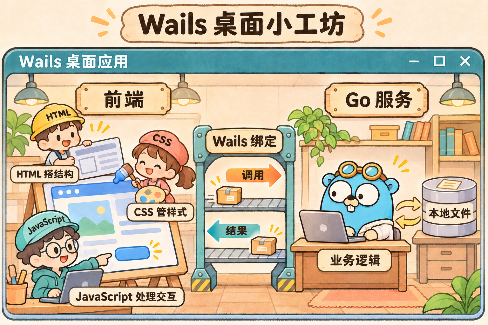
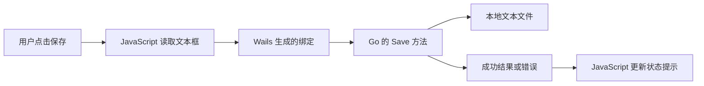
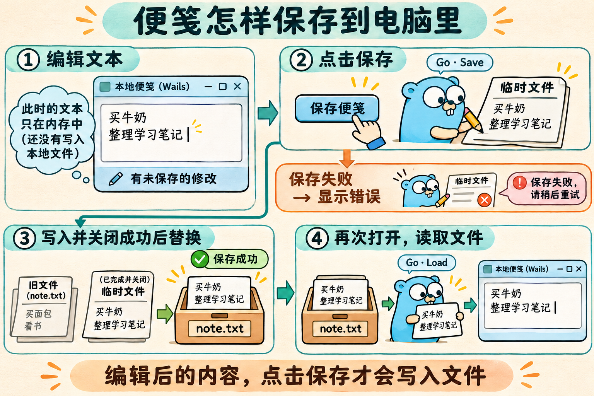
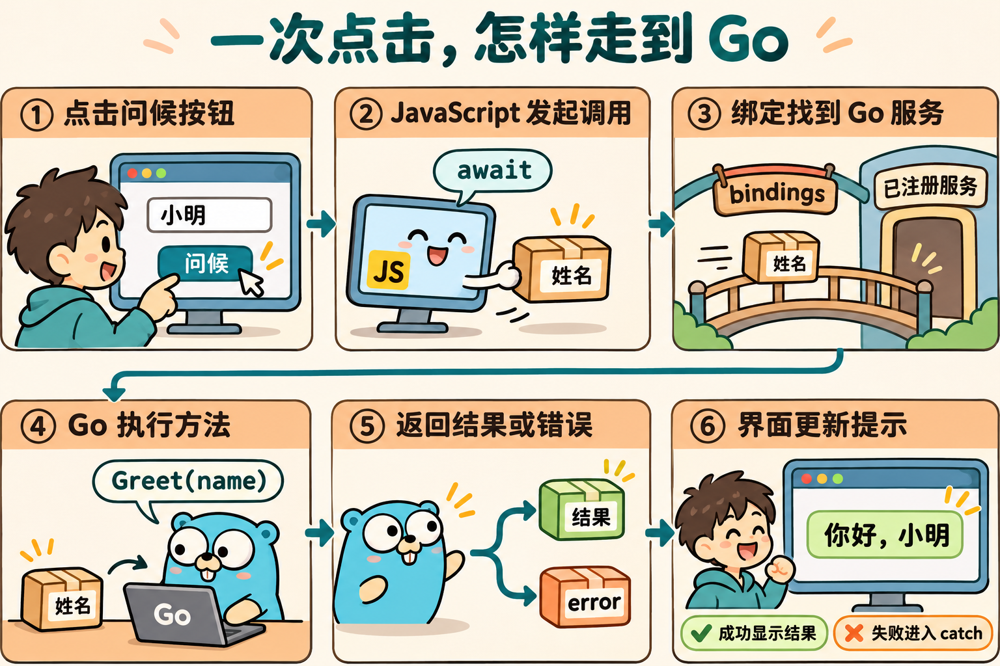

# Wails v3 从零开始学习文档

从认识编程工具，到完成一个能保存内容的桌面便笺应用。

**适用读者**　第一次接触 Go、网页开发和桌面应用开发的学习者。

**学习主线**　Windows + PowerShell + Go + HTML/CSS/JavaScript + Wails v3。

**版本基线**　Wails v3.0.0。资料核对日期为 2026 年 11 月 9 日。

本文按桌面端正式版编写。Wails v3.0.0 已正式发布，要求 Go 1.26 或更高版本。安装时选用官方当前维护的 Go 补丁版本。本文固定 Wails 版本，便于复现命令和示例。[Wails v3.0.0 发布说明](https://github.com/wailsapp/wails/releases/tag/v3.0.0)

## 配套代码

本仓库按章节保存独立示例。点击下表中的目录查看源码和练习指南。

| 章节 | 目录 | 内容 |
| --- | --- | --- |
| 第 2 章 | [环境准备](chapters/02-environment) | 安装与环境检查命令 |
| 第 3 章 | [终端入门](chapters/03-terminal) | PowerShell 命令清单 |
| 第 4 章 | [Go 基础](chapters/04-go-basics) | 七组独立 Go 示例 |
| 第 5 章 | [网页基础](chapters/05-web-basics) | HTML、CSS、JavaScript 与异步模块 |
| 第 6 章 | [第一个 Wails 项目](chapters/06-first-wails) | 模板、问候服务与界面修改 |
| 第 7 章 | [本地便笺](chapters/07-local-notes) | 文件读写与保存状态 |
| 第 8 章 | [调用流程](chapters/08-call-flow) | 生成绑定、源码追踪与 JSON 模型 |
| 第 9 章 | [桌面扩展](chapters/09-desktop-features) | 事件、窗口、文件选择与生命周期 |
| 第 10 章 | [调试排错](chapters/10-debugging) | 健康工程与故障、修复对照 |

第 1 章介绍概念，第 11 章在已有工程中练习构建，第 12 章安排复习与扩展。

已安装第 2 章的工具后，可在仓库根目录进入某章工程并启动。

```powershell
Set-Location .\chapters\07-local-notes\project\first-wails
wails3 dev
```

每个 Wails 工程包含首次生成绑定需要的 `frontend/dist/index.html` 占位文件，开发或构建任务会生成实际页面。第 8 章附带生成的绑定供阅读，修改 Go 服务后通过工具重新生成。

## 目录

- [第 1 章 先认识 Wails](#第-1-章-先认识-wails)
- [第 2 章 准备工具和开发环境](#第-2-章-准备工具和开发环境)
- [第 3 章 第一次使用终端](#第-3-章-第一次使用终端)
- [第 4 章 学会够用的 Go](#第-4-章-学会够用的-go)
- [第 5 章 学会够用的网页基础](#第-5-章-学会够用的网页基础)
- [第 6 章 运行第一个 Wails 项目](#第-6-章-运行第一个-wails-项目)
- [第 7 章 实战，制作本地便笺](#第-7-章-实战制作本地便笺)
- [第 8 章 读懂整个调用过程](#第-8-章-读懂整个调用过程)
- [第 9 章 事件、窗口和文件对话框](#第-9-章-事件窗口和文件对话框)
- [第 10 章 调试和排错](#第-10-章-调试和排错)
- [第 11 章 构建与打包](#第-11-章-构建与打包)
- [第 12 章 两周学习计划与练习](#第-12-章-两周学习计划与练习)
- [附录 命令速查与后续资料](#附录-命令速查与后续资料)

## 第 1 章 先认识 Wails

### 1.1 最终会做出什么

本文围绕一个“本地便笺”应用展开。完成后，你可以做到以下几件事。

- 在桌面窗口中输入姓名，让 Go 返回一句问候。
- 在文本框中编辑便笺。
- 点击保存，把内容写入本机文件。
- 关闭应用，再次打开后读回已保存的内容。
- 构建一个可以双击启动的 Windows 程序。

每章都有可观察的结果。遇到陌生语法时，可以先运行示例，再回来看解释。

### 1.2 Wails 由哪些部分组成

Wails 把 Go 和网页界面连接起来。Go 处理业务逻辑和本机资源，HTML、CSS、JavaScript 负责展示与交互。窗口中的网页由系统 WebView 渲染。Windows 使用 WebView2，macOS 使用 WebKit，Linux 使用 WebKitGTK。[Wails 架构说明](https://v3.wails.io/concepts/architecture/)



*图 1，把应用想成一个小工坊。左侧界面显示在 WebView 中，中间的绑定连接 JavaScript 与 Go 服务，右侧 Go 处理业务和本机文件。包裹代表一次调用或返回的数据。*

| 名称 | 可以怎样理解 | 本文中的用途 |
| --- | --- | --- |
| Go | 一门编译型编程语言 | 读取和保存便笺 |
| HTML | 界面的内容和结构 | 输入框、按钮、标题 |
| CSS | 界面的样式规则 | 颜色、间距、布局 |
| JavaScript | 让界面响应操作的语言 | 处理点击、调用 Go、更新提示 |
| WebView | 程序窗口中的网页渲染组件 | 显示界面 |
| Wails | 管理窗口并连接前后端的框架 | 注册服务、生成绑定、构建应用 |
| 绑定 bindings | 根据 Go 方法生成的前端调用代码 | 让 JavaScript 调用 `Save()` |

一次保存操作可以画成下面这样。



### 1.3 前端和后端分别写什么

以“保存便笺”为例，前端知道输入框里写了什么，负责在点击按钮后显示结果。后端确定保存位置，执行文件读写，并报告失败原因。

这样拆分以后，界面样式可以单独调整，文件保存规则也可以单独调整。

### 1.4 第一阶段要学到什么程度

先掌握下面这条完整链路。

```text
写 Go 方法 → 注册服务 → 生成绑定 → 在 JavaScript 中调用 → 显示结果
```

前端框架、数据库、多窗口和托盘可以放到完成便笺应用之后学习。

## 第 2 章 准备工具和开发环境

本章命令和下载入口已整理成可复制清单。[第 2 章命令清单](chapters/02-environment/命令清单.md)

### 2.1 安装清单

| 工具 | 作用 | 安装后的检查命令 |
| --- | --- | --- |
| Go 1.26+ 的受维护补丁版本 | 编译 Go 和安装 Wails CLI | `go version` |
| 当前受支持的 Node.js LTS | 运行本文模板的前端构建工具 | `node --version` |
| npm | 安装前端依赖，通常随 Node.js 安装 | `npm.cmd --version` |
| 代码编辑器 | 编辑项目文件，可使用 VS Code | 能打开项目文件夹 |
| WebView2 Runtime | 在 Windows 窗口中渲染网页 | `wails3 doctor` |

Go 和平台依赖由 Wails 的安装说明规定。本文使用 Vite 模板，因此还需要 Node.js 和 npm。[Wails 安装说明](https://v3.wails.io/quick-start/installation/)

下载入口如下。

- Go 安装包。[Go 官方下载](https://go.dev/dl/)
- Node.js 安装包，选择当前 LTS，并保留 npm 和 PATH 相关安装选项。[Node.js 官方下载](https://nodejs.org/en/download)
- VS Code 编辑器。[VS Code 官方下载](https://code.visualstudio.com/Download)
- 如果环境检查报告缺少 WebView2，安装 Evergreen Runtime。[Microsoft WebView2 下载](https://developer.microsoft.com/en-us/microsoft-edge/webview2/)

安装完成后，关闭旧终端，重新打开 PowerShell，再逐行执行检查命令。

```powershell
go version
node --version
npm.cmd --version
```

正常时，每条命令都会输出版本号。`npm.cmd` 用于 Windows PowerShell，可以避开 `npm.ps1` 受脚本执行策略限制的问题。macOS 和 Linux 中把本文的 `npm.cmd` 写为 `npm`。

### 2.2 安装 Wails v3 CLI

CLI 是“命令行工具”的缩写。安装后，你可以通过 `wails3` 创建和构建项目。

```powershell
go install github.com/wailsapp/wails/v3/cmd/wails3@v3.0.0
```

第一次执行需要下载依赖并编译，等待命令结束，再执行环境检查。

```powershell
wails3 doctor
```

阅读诊断输出中的缺失项目和处理建议。基础开发环境就绪后，再进入下一章。官方还提供实验性的 `wails3 setup` 安装向导。[Wails 安装与检查](https://v3.wails.io/getting-started/installation/)

### 2.3 提示找不到 wails3 时怎么办

Go 安装的命令默认放在 `GOPATH` 下的 `bin` 目录中，显式设置了 `GOBIN` 时会使用该目录。先定位实际位置。

```powershell
go env GOBIN
go env GOPATH
Get-Command wails3 -ErrorAction SilentlyContinue
```

常见默认位置如下，其中“你的用户名”需要对应实际账户。

```text
C:\Users\你的用户名\go\bin
```

把实际安装目录加入 Windows 的用户 `Path` 环境变量，然后重新打开终端。也可以先用完整路径调用文件，验证安装是否成功。

```powershell
& "$env:USERPROFILE\go\bin\wails3.exe" doctor
```

这条命令适用于默认安装目录。如果你的 `GOBIN` 或 `GOPATH` 有自定义设置，按实际位置修改。

### 2.4 macOS 和 Linux 的补充

macOS 需要 Xcode Command Line Tools，可通过下列命令安装。

```bash
xcode-select --install
```

Linux 默认构建栈使用 GTK4 和 WebKitGTK 6.0，需要 C 编译工具和对应开发包。以 Ubuntu 24.04+ 或 Debian 13+ 为例，可以按官方说明安装以下依赖，然后运行 `wails3 doctor`。[平台安装说明](https://v3.wails.io/quick-start/installation/)

```bash
sudo apt update
sudo apt install build-essential pkg-config libgtk-4-dev libwebkitgtk-6.0-dev
```

其他发行版按官方对应条目安装，具体包名取决于发行版。

## 第 3 章 第一次使用终端

本章命令与练习步骤已整理成可复制清单。[第 3 章命令清单](chapters/03-terminal/命令清单.md)

### 3.1 终端是什么

终端允许你用文字向电脑发出操作指令。PowerShell 是 Windows 上常用的一种命令解释器。

你在教程里看到的代码块有两类。

- 标注 `powershell` 或 `bash` 的内容，在终端执行。
- 标注 `go`、`html`、`css`、`javascript` 的内容，保存到指定文件中。

复制命令时，复制代码块中的命令文字。终端提示符、教程的代码框边界都属于显示界面。

### 3.2 文件夹和当前位置

每个终端都有一个“当前文件夹”。同一条命令在不同目录执行，可能会操作不同项目。

先在自己有写入权限的位置建立一个学习目录，例如 `C:\dev\wails-learning`。也可以使用文档目录下的学习文件夹。

```powershell
New-Item -ItemType Directory -Path C:\dev\wails-learning -Force
Set-Location C:\dev\wails-learning
Get-Location
```

最后一条命令显示当前目录。后续提到“在项目根目录执行”，表示先进入包含该项目 `go.mod` 和 `Taskfile.yml` 的文件夹。

| 命令 | 含义 |
| --- | --- |
| `Get-Location` | 查看当前目录 |
| `Get-ChildItem` | 查看当前目录的文件 |
| `Set-Location 文件夹路径` | 进入一个文件夹 |
| `cd ..` | 回到上一层 |
| `Ctrl+C` | 在终端中停止正在运行的开发命令 |

路径带空格时，用英文双引号包住整个路径。

```powershell
Set-Location "C:\dev\My Wails Project"
```

### 3.3 保存文件时的三个习惯

1. 用编辑器打开整个项目文件夹，方便确认文件位置。
2. 按教程要求保留扩展名，例如 `main.go`、`main.js`。
3. 文件使用 UTF-8 编码，修改后按 `Ctrl+S` 保存。

**本章检查**　你能查看当前位置、进入一个文件夹，并创建和保存一个文本文件。

## 第 4 章 学会够用的 Go

配套材料包含七组可直接运行的完整示例。[第 4 章练习指南](chapters/04-go-basics/练习指南.md) · [查看 Go 练习代码](chapters/04-go-basics)

### 4.1 运行第一个 Go 程序

在学习目录下创建单独的练习目录。

```powershell
New-Item -ItemType Directory -Path go-basics
Set-Location go-basics
go mod init example.com/learn/go-basics
```

`go mod init` 为当前文件夹建立一个 Go 模块，生成 `go.mod`。模块名用来标识这个项目，示例中的 `example.com` 无须注册或访问。

创建 `main.go`，写入以下完整内容。

```go
package main

import "fmt"

func main() {
    name := "小明"
    fmt.Println("你好，" + name)
}
```

在这个目录中执行。

```powershell
go run .
```

预期输出如下。

```text
你好，小明
```

| 代码 | 含义 |
| --- | --- |
| `package main` | 当前文件属于可执行程序的入口包 |
| `import "fmt"` | 使用 Go 标准库中的格式化输出功能 |
| `func main()` | 程序从这个函数开始执行 |
| `name := "小明"` | 创建变量，由编译器推断为字符串 |
| `fmt.Println(...)` | 输出一行文字 |
| `+` | 在这里用于连接字符串 |

### 4.2 变量、类型和函数

下面这些语句放在 `main()` 的花括号里时，都是合法的变量声明。

```go
var title string = "我的便笺"
count := 3
saved := true

fmt.Println(title, count, saved)
```

`string` 表示字符串，`int` 常用于整数，`bool` 只有 `true` 和 `false` 两种值。

函数把一个操作封装起来。下面的函数接收一个名字，返回一句话。把它放在 `main()` 外面。

```go
func greet(name string) string {
    return "你好，" + name
}
```

再在 `main()` 里调用它。

```go
message := greet("小明")
fmt.Println(message)
```

理解函数签名时，从左到右读。`greet` 是函数名，`name string` 表示参数和类型，右侧的 `string` 表示返回值类型。

### 4.3 if 和 error

文件操作可能因为权限、文件损坏或磁盘状态失败。Go 通常通过 `error` 返回失败信息。`nil` 表示这里没有错误。

下面是一个完整练习。用它替换练习目录中的 `main.go`，然后再次执行 `go run .`。

```go
package main

import (
    "fmt"
    "strings"
)

func greet(name string) (string, error) {
    name = strings.TrimSpace(name)
    if name == "" {
        return "", fmt.Errorf("请输入姓名")
    }
    return "你好，" + name, nil
}

func main() {
    message, err := greet("小明")
    if err != nil {
        fmt.Println("操作失败", err)
        return
    }
    fmt.Println(message)
}
```

- `(string, error)` 表示同时返回一个字符串和一个错误。
- `message, err := ...` 接收这两个返回值。
- `if err != nil` 检查失败情况。
- `return` 结束当前函数。
- `strings.TrimSpace` 去掉首尾空白。

把调用参数改为 `"   "`，观察程序如何走到错误分支。

### 4.4 struct 和方法

`struct` 是结构体，可以把相关数据组合起来。方法是附着在某个类型上的函数。

下面这段代码是 Wails 服务的典型形状。可以先读懂，再在第 6 章的项目中查看实际文件。

```go
type GreetService struct{}

func (g *GreetService) Greet(name string) string {
    return "你好，" + name
}
```

逐项理解如下。

| 代码 | 含义 |
| --- | --- |
| `type GreetService struct{}` | 定义一个暂时没有数据字段的结构体类型 |
| `(g *GreetService)` | 这个方法属于 `GreetService`，`g` 用于访问该实例 |
| `*GreetService` | 指向服务实例的指针，方法可以操作同一个实例的状态 |
| `Greet` | 方法名，以大写字母开头，属于导出方法 |
| `&GreetService{}` | 创建服务值并取得它的地址 |

Wails 可以把已注册服务中符合绑定规则的导出方法暴露给前端。普通的包级函数需要通过服务方法组织后才能按本文方式调用。[Wails 服务说明](https://v3.wails.io/features/bindings/services/)

### 4.5 后面会用到的语法

| 写法 | 含义 |
| --- | --- |
| `[]string` | 字符串切片，可以理解为可变长度列表 |
| `if err := action(); err != nil` | 执行操作，在判断里检查返回的错误 |
| `defer cleanup()` | 在当前函数返回前执行清理 |
| `fmt.Errorf("读取失败 %w", err)` | 为原始错误补充上下文，同时保留错误关系 |
| `sync.Mutex` | 互斥锁，用于协调同一进程内的并发操作 |

**本章检查**　你能写一个接收两个整数并返回和的函数，也能解释 `if err != nil` 的用途。

## 第 5 章 学会够用的网页基础

配套材料包含可运行的问候页面、多行文本与本地异步模块练习。[第 5 章练习指南](chapters/05-web-basics/练习指南.md) · [查看网页练习代码](chapters/05-web-basics)

### 5.1 一个可直接练习的页面

在任意练习文件夹中创建 `playground.html`，保存以下完整内容，然后用浏览器打开。

```html
<!doctype html>
<html lang="zh-CN">
<head>
    <meta charset="UTF-8">
    <meta name="viewport" content="width=device-width, initial-scale=1.0">
    <title>网页基础练习</title>
    <style>
        body {
            max-width: 600px;
            margin: 48px auto;
            padding: 0 16px;
            font-family: sans-serif;
        }
        button {
            padding: 8px 16px;
        }
    </style>
</head>
<body>
    <h1>我的第一个交互页面</h1>
    <label for="name">姓名</label>
    <input id="name" placeholder="请输入姓名">
    <button id="greet" type="button">打招呼</button>
    <p id="result" role="status"></p>

    <script>
        const nameInput = document.getElementById("name");
        const result = document.getElementById("result");
        const button = document.getElementById("greet");

        button.addEventListener("click", () => {
            const name = nameInput.value.trim();
            result.textContent = name ? `你好，${name}` : "请先输入姓名";
        });
    </script>
</body>
</html>
```

这个练习中的问候在 JavaScript 内部生成。进入 Wails 项目后，我们会把问候交给 Go 生成。

### 5.2 HTML 负责结构

| 标签或属性 | 用途 |
| --- | --- |
| `<h1>` | 页面主要标题 |
| `<input>` | 单行输入框 |
| `<textarea>` | 多行文本框 |
| `<button>` | 按钮 |
| `<p>` | 一段文本 |
| `<label for="name">` | 给指定输入控件提供名称 |
| `id="name"` | 为元素设置当前页面内唯一的标识 |
| `<script type="module">` | 加载支持 `import` 的 JavaScript 模块 |

### 5.3 CSS 负责外观

```css
button {
    background: #2563eb;
    color: white;
    border-radius: 8px;
}
```

`button` 是选择器，表示这些样式作用于按钮。花括号里是属性和值。`padding` 表示内边距，`margin` 表示外边距，`border-radius` 控制圆角。

### 5.4 JavaScript 负责交互

```javascript
const button = document.getElementById("greet");
button.addEventListener("click", () => {
    console.log("按钮被点击了");
});
```

这里先从页面中找到按钮，再注册点击处理函数。处理函数会在用户点击后执行。

- `const` 声明变量绑定，`let` 用于后面需要重新赋值的变量。
- `document` 提供对页面结构的访问。
- `value` 用于读取输入框或文本框的内容。
- `textContent` 用于把结果作为文字显示在页面里。
- `console.log` 用于输出调试信息。
- `` `你好，${name}` `` 是模板字符串，可在文字中插入变量。
- `条件 ? 值A : 值B` 根据条件选择一个结果。

### 5.5 import、Promise 和 await

较大的项目会把代码拆成多个模块。`import` 用于使用另一个模块导出的功能。

```javascript
import { Greet } from "./greetservice.js";
```

这段代码中的路径只是模块语法示意。第 7 章会给出项目中实际存在的绑定路径。

前端调用 Go 时，需要等待调用完成。绑定函数返回 Promise，可以理解为代表一次尚未完成操作的对象。在 `async` 函数中用 `await` 取得完成后的结果，用 `try/catch` 处理失败。

```javascript
async function showGreeting() {
    try {
        const message = await Greet("小明");
        console.log(message);
    } catch (error) {
        console.error(error);
    }
}
```

**本章检查**　你能让页面上的按钮读取输入框，并把结果显示在段落中。

## 第 6 章 运行第一个 Wails 项目

配套材料包含可启动的完整项目源码。[第 6 章练习指南](chapters/06-first-wails/练习指南.md) · [查看 Wails 项目示例](chapters/06-first-wails)

### 6.1 创建项目

回到学习目录，创建 Wails 项目。

```powershell
Set-Location C:\dev\wails-learning
wails3 init -n first-wails -t vanilla-js -mod example.com/learn/first-wails
Set-Location first-wails
wails3 dev
```

如果前面用了其他学习目录，把第一条命令中的路径换成自己的位置。

| 参数 | 本文中的含义 |
| --- | --- |
| `-n first-wails` | 项目名称 |
| `-t vanilla-js` | 选择原生 JavaScript + Vite 模板 |
| `-mod example.com/learn/first-wails` | 明确 Go 模块路径，后续绑定导入路径也由它决定 |

`vanilla-js` 对应本文的 `main.js`。创建项目时明确模板和模块路径，可以让后续代码位置保持一致。[首个应用教程](https://v3.wails.io/quick-start/first-app/)、[CLI 参数说明](https://v3.wails.io/guides/cli/)

第一次启动会安装依赖、生成绑定并编译。正常结果是出现一个桌面窗口，输入名字后能获得问候。

### 6.2 认识目录

下面列出学习过程中常用的位置。有些目录会在首次开发或构建时生成。

```text
first-wails/
├── main.go                  应用入口，注册服务和创建窗口
├── greetservice.go          问候服务
├── go.mod                   Go 模块名称和依赖
├── go.sum                   Go 依赖校验信息
├── Taskfile.yml             顶层开发和构建任务
├── build/                   平台任务、图标和应用元数据
├── frontend/
│   ├── index.html           界面入口
│   ├── package.json         前端依赖和脚本
│   ├── vite.config.js       Vite 配置
│   ├── src/main.js          界面交互逻辑
│   ├── public/style.css     样式
│   ├── bindings/            Wails 自动生成的前端绑定
│   └── dist/                前端构建产物
└── bin/                     应用构建产物
```

`bindings` 和 `dist` 都是生成目录。修改功能时，编辑 Go 服务和前端源文件，再通过开发或构建命令重新生成产物。[项目结构说明](https://v3.wails.io/guides/dev/project-structure/)

### 6.3 第一次修改 Go

打开 `greetservice.go`，用下面的完整内容替换它。

```go
package main

import (
    "fmt"
    "strings"
)

type GreetService struct{}

func (g *GreetService) Greet(name string) (string, error) {
    name = strings.TrimSpace(name)
    if name == "" {
        return "", fmt.Errorf("请输入姓名")
    }
    return "你好，" + name + "！欢迎学习 Wails v3。", nil
}
```

保存后，开发模式会重新编译 Go 并重启应用。再次输入名字，观察返回的中文问候。[开发工作流程](https://v3.wails.io/quick-start/first-app/)

### 6.4 第一次修改界面

打开 `frontend/index.html`，找到模板中的标题，修改成自己喜欢的文字并保存。观察窗口更新。

完成这些尝试后，进入下一章，用完整代码把模板改造成便笺应用。

**本章检查**　你能启动应用，修改 Go 返回内容，修改 HTML 标题，并看到两种修改产生的结果。

## 第 7 章 实战，制作本地便笺

配套材料包含可启动的完整便笺工程与首次生成绑定的占位文件。[第 7 章练习指南](chapters/07-local-notes/练习指南.md) · [查看 Wails 便笺项目](chapters/07-local-notes)

本章接着使用第 6 章的 `first-wails` 项目。先在终端按 `Ctrl+C` 停止开发命令，完成文件修改后再启动。

需要完成以下文件操作。

| 文件 | 操作 |
| --- | --- |
| `greetservice.go` | 使用第 6.3 节的完整内容 |
| `noteservice.go` | 新建文件 |
| `main.go` | 用本章完整内容替换 |
| `frontend/index.html` | 用本章完整内容替换 |
| `frontend/public/style.css` | 用本章完整内容替换 |
| `frontend/src/main.js` | 用本章完整内容替换 |

### 7.1 新建 noteservice.go

这个服务提供三个方法。`Load` 读取便笺，`Save` 保存便笺，`FilePath` 返回数据文件路径。



*图 2，按①→②→③→④阅读。青色箭头连接成功流程，橙色分支表示保存失败。编辑时的新修改先留在内存里，点击保存并成功完成文件操作后，下一次打开才能读回这些修改。*

```go
package main

import (
    "errors"
    "fmt"
    "os"
    "path/filepath"
    "sync"
)

type NoteService struct {
    mu   sync.Mutex
    path string
}

func NewNoteService() (*NoteService, error) {
    configDir, err := os.UserConfigDir()
    if err != nil {
        return nil, fmt.Errorf("获取用户配置目录失败 %w", err)
    }

    appDir := filepath.Join(configDir, "WailsLearningNote")
    if err := os.MkdirAll(appDir, 0700); err != nil {
        return nil, fmt.Errorf("创建便笺目录失败 %w", err)
    }

    return &NoteService{
        path: filepath.Join(appDir, "note.txt"),
    }, nil
}

func (s *NoteService) Load() (string, error) {
    s.mu.Lock()
    defer s.mu.Unlock()

    content, err := os.ReadFile(s.path)
    if errors.Is(err, os.ErrNotExist) {
        return "", nil
    }
    if err != nil {
        return "", fmt.Errorf("读取便笺失败 %w", err)
    }
    return string(content), nil
}

func (s *NoteService) Save(text string) error {
    s.mu.Lock()
    defer s.mu.Unlock()

    file, err := os.CreateTemp(filepath.Dir(s.path), ".note-*.tmp")
    if err != nil {
        return fmt.Errorf("创建临时文件失败 %w", err)
    }
    tempPath := file.Name()
    defer os.Remove(tempPath)

    if _, err := file.WriteString(text); err != nil {
        _ = file.Close()
        return fmt.Errorf("写入便笺失败 %w", err)
    }
    if err := file.Close(); err != nil {
        return fmt.Errorf("关闭临时文件失败 %w", err)
    }
    if err := os.Rename(tempPath, s.path); err != nil {
        return fmt.Errorf("替换便笺文件失败 %w", err)
    }
    return nil
}

func (s *NoteService) FilePath() string {
    return s.path
}
```

先理解这段实现的几个选择。

- 数据保存在当前用户的配置目录。这样从开发目录或构建后的程序启动，都能找到相同位置。
- 首次运行时，便笺文件尚不存在，`Load` 返回空文本。
- 同一个服务实例通过互斥锁协调读取和保存。
- 保存先写入同目录临时文件，写入和关闭成功后才替换目标，降低直接覆盖时写入中途失败的影响。
- 所有实际读写失败都会返回错误，前端可以显示失败信息。

此示例按单个应用实例使用设计。互斥锁的作用范围是当前进程。多个进程同时编辑时，最终内容取决于保存顺序。临时文件替换在不同系统上的原子性和断电持久性需要单独评估。Go 的文件操作和配置目录行为以标准库文档为准。[Go os 包](https://pkg.go.dev/os)

### 7.2 完整替换 main.go

```go
package main

import (
    "embed"
    "log"

    "github.com/wailsapp/wails/v3/pkg/application"
)

//go:embed all:frontend/dist
var assets embed.FS

func main() {
    noteService, err := NewNoteService()
    if err != nil {
        log.Fatal(err)
    }

    app := application.New(application.Options{
        Name:        "first-wails",
        Description: "Wails v3 零基础便笺示例",
        Services: []application.Service{
            application.NewService(&GreetService{}),
            application.NewService(noteService),
        },
        Assets: application.AssetOptions{
            Handler: application.AssetFileServerFS(assets),
        },
        Mac: application.MacOptions{
            ApplicationShouldTerminateAfterLastWindowClosed: true,
        },
    })

    app.Window.NewWithOptions(application.WebviewWindowOptions{
        Title:            "我的 Wails 便笺",
        Width:            900,
        Height:           700,
        BackgroundColour: application.NewRGB(245, 247, 251),
        URL:              "/",
    })

    if err := app.Run(); err != nil {
        log.Fatal(err)
    }
}
```

这里完成四件事。

1. 创建便笺服务，提前检查数据目录能否使用。
2. 把问候服务和便笺服务注册给应用。
3. 设置前端资源，创建一个窗口。
4. 调用 `app.Run()`，启动应用事件循环。

`//go:embed` 是编译指令，负责把前端构建目录嵌入程序。按后面的 Wails 命令开发和构建，相关任务会准备前端产物。

### 7.3 完整替换 frontend/index.html

```html
<!doctype html>
<html lang="zh-CN">
<head>
    <meta charset="UTF-8">
    <meta name="viewport" content="width=device-width, initial-scale=1.0">
    <title>我的 Wails 便笺</title>
    <link rel="stylesheet" href="/style.css">
</head>
<body>
    <main class="app">
        <h1>我的 Wails 便笺</h1>
        <p class="description">练习前后端调用，把一段文字保存到本机。</p>

        <section class="card">
            <h2>先打个招呼</h2>
            <form id="greet-form" class="row">
                <label for="name">姓名</label>
                <input id="name" autocomplete="name" placeholder="请输入姓名">
                <button id="greet-button" type="submit">问候</button>
            </form>
            <p id="greeting" role="status" aria-live="polite"></p>
        </section>

        <section class="card">
            <h2><label for="note">今天想记下什么</label></h2>
            <textarea id="note" rows="10" disabled placeholder="正在读取便笺"></textarea>
            <div class="toolbar">
                <button id="save-button" type="button" disabled>保存便笺</button>
                <span id="note-status" role="status" aria-live="polite">正在加载</span>
            </div>
            <p class="path">保存位置 <code id="file-path"></code></p>
        </section>
    </main>
    <script type="module" src="/src/main.js"></script>
</body>
</html>
```

### 7.4 完整替换 frontend/public/style.css

```css
* {
    box-sizing: border-box;
}

body {
    margin: 0;
    background: #f5f7fb;
    color: #172033;
    font-family: "Segoe UI", "Microsoft YaHei", sans-serif;
}

.app {
    max-width: 860px;
    margin: 0 auto;
    padding: 28px 20px;
}

h1 {
    margin-top: 0;
}

h2 {
    margin-top: 0;
    font-size: 18px;
}

.description, .path {
    color: #526078;
}

.card {
    margin-top: 20px;
    padding: 22px;
    border: 1px solid #dde3ee;
    border-radius: 14px;
    background: white;
}

.row, .toolbar {
    display: flex;
    align-items: center;
    flex-wrap: wrap;
    gap: 12px;
}

input, textarea, button {
    font: inherit;
}

input, textarea {
    padding: 10px 12px;
    border: 1px solid #b8c4d8;
    border-radius: 8px;
}

input {
    flex: 1;
    min-width: 160px;
}

textarea {
    display: block;
    width: 100%;
    min-height: 200px;
    margin-bottom: 16px;
    resize: vertical;
    line-height: 1.7;
}

button {
    padding: 10px 18px;
    border: 0;
    border-radius: 8px;
    background: #2563eb;
    color: white;
    cursor: pointer;
}

button:disabled {
    opacity: 0.55;
    cursor: wait;
}

input:focus-visible, textarea:focus-visible, button:focus-visible {
    outline: 3px solid #93c5fd;
    outline-offset: 2px;
}

.path {
    margin-bottom: 0;
    overflow-wrap: anywhere;
    font-size: 13px;
}
```

### 7.5 完整替换 frontend/src/main.js

```javascript
import "@wailsio/runtime";
import { GreetService, NoteService } from "../bindings/example.com/learn/first-wails/index.js";

const greetForm = document.getElementById("greet-form");
const nameInput = document.getElementById("name");
const greetButton = document.getElementById("greet-button");
const greeting = document.getElementById("greeting");
const noteInput = document.getElementById("note");
const saveButton = document.getElementById("save-button");
const noteStatus = document.getElementById("note-status");
const filePath = document.getElementById("file-path");

let savedText = "";

function describeError(error) {
    return error instanceof Error ? error.message : String(error);
}

greetForm.addEventListener("submit", async (event) => {
    event.preventDefault();
    greetButton.disabled = true;

    try {
        greeting.textContent = await GreetService.Greet(nameInput.value);
    } catch (error) {
        greeting.textContent = describeError(error);
    } finally {
        greetButton.disabled = false;
    }
});

noteInput.addEventListener("input", () => {
    noteStatus.textContent = noteInput.value === savedText
        ? "所有修改已保存"
        : "有未保存的修改";
});

saveButton.addEventListener("click", async () => {
    const textToSave = noteInput.value;
    saveButton.disabled = true;
    noteStatus.textContent = "正在保存";

    try {
        await NoteService.Save(textToSave);
        savedText = textToSave;
        noteStatus.textContent = noteInput.value === savedText
            ? "保存成功"
            : "已保存刚才的内容，当前还有新的修改";
    } catch (error) {
        noteStatus.textContent = `保存失败 ${describeError(error)}`;
    } finally {
        saveButton.disabled = false;
    }
});

async function initialise() {
    try {
        const [text, path] = await Promise.all([
            NoteService.Load(),
            NoteService.FilePath(),
        ]);

        noteInput.value = text;
        savedText = text;
        filePath.textContent = path;
        noteInput.placeholder = "写下今天想记住的内容";
        noteInput.disabled = false;
        saveButton.disabled = false;
        noteStatus.textContent = "读取完成";
    } catch (error) {
        noteStatus.textContent = `加载失败 ${describeError(error)}`;
    }
}

initialise();
```

导入路径与第 6 章指定的 Go 模块名一致。如果你使用了其他模块名，先查看生成的 `frontend/bindings` 目录，再按实际结构调整。绑定生成规则和模块路径有关。[Go 方法绑定说明](https://v3.wails.io/features/bindings/methods/)

这里的 `Promise.all` 同时等待两项独立的读取操作。保存按钮会在成功加载后启用，防止读取失败后把空白内容当作原内容覆盖保存。保存期间继续输入时，程序会区分本次已保存的快照与后来输入的内容。

### 7.6 生成绑定并启动

回到项目根目录，执行以下命令。

```powershell
gofmt -w main.go greetservice.go noteservice.go
wails3 generate bindings
wails3 dev
```

`gofmt` 统一 Go 代码格式。绑定生成成功后，应能在下面的目录中找到 `index.js` 和服务文件。

```text
frontend/bindings/example.com/learn/first-wails/
```

开发和构建任务会生成绑定。这里单独执行一次生成命令，方便观察服务和前端文件之间的关系。[绑定生成命令](https://v3.wails.io/features/bindings/methods/)

如果生成命令报告 `frontend/dist` 匹配不到文件，按第 10.4 节准备一个临时占位文件，再重试。

### 7.7 按顺序验收

| 操作 | 预期结果 |
| --- | --- |
| 输入“小明”并点击问候 | 显示来自 Go 的中文问候 |
| 姓名只输入空格并点击问候 | 显示“请输入姓名” |
| 在便笺中输入中文和多行文字 | 显示“有未保存的修改” |
| 点击保存 | 显示“保存成功”，或显示仍有后续修改 |
| 修改并再次保存 | 成功更新同一个文件 |
| 关闭后重新启动应用 | 读回最后一次保存的内容 |
| 保存空便笺，再重启 | 正确读回空文本 |
| 查看页面底部 | 能看到真实的数据文件位置 |

编辑后通过“保存便笺”提交内容。关闭程序会丢弃尚未保存的编辑。可以把“关闭前提醒”作为后续练习。

## 第 8 章 读懂整个调用过程

本章目录包含便笺工程、生成绑定、源码追踪脚本和独立模型练习。[第 8 章练习指南](chapters/08-call-flow/练习指南.md) · [查看调用流程练习包](chapters/08-call-flow)

### 8.1 点击保存后发生了什么

先用问候功能看一次完整调用，再把同样的链路套到保存操作上。



*图 3，姓名作为参数送到 Go，执行结果再回到界面。`await` 等待绑定调用完成，失败时进入 `catch`。把图中的 `Greet(name)` 换成 `Save(text)`，就得到下面的保存链路。*

```text
1. 用户点击 save-button。
2. JavaScript 读取 noteInput.value，保留本次保存快照。
3. JavaScript 调用 NoteService.Save(textToSave)。
4. 生成的绑定把参数传给已注册的 Go 服务。
5. Go 执行 Save，写临时文件并替换目标。
6. Go 返回 nil，或者返回 error。
7. Promise 完成，前端更新成功提示或错误提示。
```

Wails 桥接机制负责把前端调用送到对应服务，再把结果交回 JavaScript。[Go 与前端通信机制](https://v3.wails.io/concepts/architecture/)

### 8.2 三种常见返回方式

| Go 方法签名 | 前端等待后的结果 |
| --- | --- |
| `Greet(name string) string` | 得到字符串 |
| `Load() (string, error)` | 成功得到字符串，失败进入 `catch` |
| `Save(text string) error` | 成功完成调用，失败进入 `catch` |

前端调用绑定函数时，按 Promise 异步处理。Go 返回非空错误时，绑定调用会被拒绝。[返回值与错误处理](https://v3.wails.io/features/bindings/methods/)

### 8.3 服务注册为什么重要

只有定义 Go 类型还不够，应用需要注册要提供给前端的服务实例。

```go
Services: []application.Service{
    application.NewService(noteService),
},
```

同一个应用中的窗口可以调用注册的服务实例。服务里有共享可变状态或需要协调的操作时，要考虑并发访问。便笺示例用互斥锁串行执行文件读取与保存。[服务与并发](https://v3.wails.io/features/bindings/services/)

### 8.4 数据变复杂时怎么传

以后的便笺可能包含标题和正文，可以在 Go 中定义结构体。下面展示一种数据模型。

```go
type Note struct {
    Title   string `json:"title"`
    Content string `json:"content"`
}
```

导出的字段可以参与桥接数据转换。`json` 标签指定序列化后的字段名，前端读取时使用 `note.title` 和 `note.content`。扩展到这种模型时，同时调整服务签名与前端调用，再生成绑定。[数据模型说明](https://v3.wails.io/features/bindings/models/)

**本章检查**　关掉教程后，你能从点击按钮开始，按顺序讲完保存流程。

## 第 9 章 事件、窗口和文件对话框

配套工程合并本章四项实验，并提供项目内的文本练习文件。[第 9 章练习指南](chapters/09-desktop-features/练习指南.md) · [查看桌面扩展实验](chapters/09-desktop-features)

这一章在主线应用跑通后学习。各节是独立扩展实验，按对应位置添加代码即可。

### 9.1 使用事件发送通知

绑定方法适合表达“调用一个操作并等待结果”。事件可以表达“某件事情发生了，通知订阅者”。例如下载进度变化、后台扫描完成、多窗口内容更新。

下面做一个请求时间并接收事件的小实验。

**第一步**　在 `main.go` 的 import 列表中加入 `"time"`。

**第二步**　在创建窗口之后、`app.Run()` 之前加入以下代码。

```go
app.Event.On("note:time-request", func(event *application.CustomEvent) {
    app.Event.Emit("note:time", time.Now().Format("15:04:05"))
})
```

**第三步**　在 `frontend/index.html` 的便笺区域里增加一个段落。

```html
<p id="clock" role="status"></p>
```

**第四步**　在 `frontend/src/main.js` 中添加导入。

```javascript
import { Events } from "@wailsio/runtime";
```

在文件末尾加入以下代码。

```javascript
const clock = document.getElementById("clock");

const stopListening = Events.On("note:time", (event) => {
    clock.textContent = `Go 返回的时间 ${event.data}`;
});

Events.Emit("note:time-request").catch((error) => {
    clock.textContent = describeError(error);
});

window.addEventListener("pagehide", () => {
    stopListening();
});
```

先注册监听，再发起请求。这样界面能接收这次返回事件。事件数据从 `event.data` 读取，`Events.On` 返回取消订阅函数。组件反复创建和销毁时，应在适当的清理阶段取消监听。[事件系统](https://v3.wails.io/features/events/system/)

### 9.2 从前端修改窗口标题

在 `main.js` 中增加下面的导入。

```javascript
import { Window } from "@wailsio/runtime";
```

在文件末尾调用窗口 API，保存并观察标题。

```javascript
Window.SetTitle("正在学习 Wails v3").catch(console.error);
```

`Window` 提供当前窗口相关操作。类似地，可以继续学习调整大小、显示、隐藏等能力。[前端 Runtime 的窗口 API](https://v3.wails.io/reference/frontend-runtime/)

### 9.3 弹出系统文件选择框

先做一个启动时弹出文件选择框的小实验。在 `main.go` 创建窗口之后、`app.Run()` 之前，增加下面的应用启动事件处理。

先在 import 中加入事件包。

```go
"github.com/wailsapp/wails/v3/pkg/events"
```

再添加处理函数。

```go
app.Event.OnApplicationEvent(events.Common.ApplicationStarted, func(event *application.ApplicationEvent) {
    path, err := app.Dialog.OpenFile().
        SetTitle("选择一个文本文件").
        AddFilter("文本文件", "*.txt").
        PromptForSingleSelection()

    if err != nil {
        log.Println("文件选择未完成", err)
        return
    }
    if path == "" {
        return
    }
    log.Println("选中的文件", path)
})
```

运行后选择文件，终端会打印路径。取消时应同时处理错误返回与空路径。本次 Windows 版 Wails v3.0.0 实测取消会返回 `cancelled by user` 错误，代码先检查 `err`，再检查空路径。文件对话框返回路径后，还需要由你的 Go 代码执行读取或保存。可以接着把“导入便笺”做成一个单独的服务方法。[文件对话框](https://v3.wails.io/features/dialogs/file/)

### 9.4 服务生命周期

业务需要在启动时连接数据库、启动后台任务，或者退出时关闭资源时，可以使用服务生命周期方法。

```go
func (s *MyService) ServiceStartup(ctx context.Context, options application.ServiceOptions) error {
    return nil
}

func (s *MyService) ServiceShutdown() error {
    return nil
}
```

这是方法签名示意，`MyService` 需要换成自己的类型，并导入 `context`。后台任务应结合传入的上下文处理退出和取消。[服务生命周期](https://v3.wails.io/features/bindings/services/)

## 第 10 章 调试和排错

配套材料包含健康便笺工程、故障与修复对照。[第 10 章练习指南](chapters/10-debugging/练习指南.md) · [查看排错练习与健康工程](chapters/10-debugging)

### 10.1 先判断问题在哪一层

| 现象 | 优先检查 |
| --- | --- |
| 终端找不到命令 | 工具安装位置和 PATH |
| Go 编译报错 | 错误行、导入、方法名、返回值 |
| 页面空白或按钮没反应 | JavaScript 错误和 HTML 元素 ID |
| 找不到绑定模块 | 绑定是否生成、模块名和导入路径 |
| 页面显示“保存失败” | Go 返回的文件操作错误 |
| 重启后内容没有变化 | 本次是否保存成功、实际文件路径 |

每次修复后重复同一个操作，确认错误消失，再继续下一项修改。

### 10.2 查看日志

Go 端可以在具体步骤前后打印日志。

```go
log.Println("开始加载便笺")
```

使用时在该 Go 文件中导入 `log`。

前端使用开发者工具中的 Console 查看信息。在开发窗口中尝试右键检查，或使用当前平台可用的开发者工具入口，再观察下面这些输出。

```javascript
console.log("开始调用服务");
console.error(error);
```

`console.error(error)` 应放在已有的 `catch (error)` 中，便于查看完整错误对象。

### 10.3 最常见的初学错误

**元素 ID 对不上。** HTML 写 `id="save-button"`，JavaScript 也要使用相同字符串。查找结果为 `null` 后再调用方法，会产生前端错误。

**模块名变化了。** 先检查 `go.mod` 的第一行和 `frontend/bindings` 的实际目录，再修改前端导入路径。

**新增方法后绑定尚未更新。** 保存 Go 文件并观察开发任务是否成功，也可以在项目根目录执行 `wails3 generate bindings`。

**Go 方法或字段使用了小写名称。** 检查是否需要导出，并确认所在服务已经注册。

**操作完成前就显示成功。** 使用 `await` 等待绑定完成，再更新界面状态。

**修改了错误的项目。** 在终端执行 `Get-Location`，并确认编辑器打开的是同一个文件夹。

### 10.4 报错 frontend/dist 没有匹配文件

`main.go` 的嵌入指令要求 `frontend/dist` 中有可嵌入文件。先正常执行 `wails3 dev` 或 `wails3 build`，由任务准备构建目录。

如果你正在手动生成绑定，且缺少产物导致 Go 包加载失败，可以先创建占位文件。下面只在占位文件缺失时写入它。

```powershell
New-Item -ItemType Directory -Path frontend\dist -Force | Out-Null
if (-not (Test-Path -LiteralPath frontend\dist\index.html)) {
    Set-Content -LiteralPath frontend\dist\index.html -Value '<!doctype html><title>Loading</title>' -Encoding utf8
}
wails3 generate bindings
wails3 dev
```

正常的前端构建会重新生成 `dist` 内容。日常编辑在 `frontend/index.html` 和 `frontend/src` 等源文件中进行。

### 10.5 npm 执行失败

如果 PowerShell 报告 `npm.ps1` 执行策略问题，先尝试 `npm.cmd`。如果是依赖安装错误，在前端目录单独执行，查看实际报错。

```powershell
Set-Location frontend
npm.cmd install
Set-Location ..
```

网络错误需要检查连接与代理设置。版本错误需要检查 Node.js 版本是否满足模板中 Vite 的要求。

### 10.6 开发端口被占用

先停止之前启动的开发命令，再重试。如果需要更换开发端口，可以执行下面的命令。[开发命令参数](https://v3.wails.io/guides/cli/)

```powershell
wails3 dev -port 9246
```

### 10.7 分享问题时附上什么

- 完整执行命令。
- 命令所在目录。
- 第一条具体错误及其前后几行。
- `go version`、`node --version` 和 `wails3 doctor` 中相关信息。
- 最近修改的文件和最短复现步骤。

## 第 11 章 构建与打包

### 11.1 开发模式和正式构建

| 模式 | 命令 | 主要用途 |
| --- | --- | --- |
| 开发模式 | `wails3 dev` | 编辑、观察变化、调试 |
| 应用构建 | `wails3 build` | 编译当前平台可执行程序 |
| 分发打包 | `wails3 package` | 调用平台任务生成分发包 |

Wails v3 的构建流程由生成的 Taskfile 组织。前端构建、绑定生成和 Go 编译通过这些任务衔接。[构建应用](https://v3.wails.io/guides/build/building/)

### 11.2 构建 Windows 程序

停止开发命令，在项目根目录执行。

```powershell
wails3 build
```

正常结束后，检查 `bin` 目录。本文项目的默认 Windows 程序路径如下。

```text
bin/first-wails.exe
```

在终端运行，或在资源管理器中双击打开。

```powershell
.\bin\first-wails.exe
```

重新测试输入、保存、关闭和再次打开。正式构建使用嵌入的前端资源。[构建输出说明](https://v3.wails.io/guides/build/building/)

### 11.3 创建安装包

默认 Windows 安装包使用 NSIS，需要安装对应打包工具。按照官方 Windows 打包指南准备工具后执行。[Windows 打包说明](https://v3.wails.io/guides/build/windows/)

```powershell
wails3 package GOOS=windows
```

安装器通常生成到以下路径，实际名称以构建任务输出为准。

```text
bin/<应用名>-<架构>-installer.exe
```

Windows 用户运行应用时需要 WebView2 Runtime。默认安装包流程包含处理该运行时的引导程序。离线分发可按 Microsoft 的安装方式准备独立运行时。[Windows 运行时与安装器](https://v3.wails.io/guides/build/windows/)

### 11.4 跨平台怎么理解

同一个项目可以面向多个平台开发。每个平台仍有自己的工具链、系统库和分发格式。学习时先完成当前平台构建，再按官方流程配置跨平台构建环境。[跨平台构建](https://v3.wails.io/guides/build/cross-platform/)

### 11.5 发布前自己走一遍

- 在构建后的程序里测试问候、读取和保存。
- 关闭终端后，单独启动构建出的应用。
- 检查中文、多行文本和空文本。
- 重启后确认最后一次保存成功的内容可以恢复。
- 在目标机器上检查 WebView2 和安装包运行情况。

## 第 12 章 两周学习计划与练习

下面按每天约 45～90 分钟设计。卡在某一步时，按实际情况延长练习时间。

### 12.1 第一周，先跑通一条完整链路

| 天数 | 学习内容 | 当天可观察的结果 |
| --- | --- | --- |
| 第 1 天 | 第 1～3 章，环境和终端 | `doctor` 检查通过，能切换目录 |
| 第 2 天 | 第 4.1～4.3 节 | Go 程序能输出结果和错误 |
| 第 3 天 | 第 4.4～4.5 节 | 能解释结构体、方法和导出名称 |
| 第 4 天 | 第 5 章 | 网页按钮能更新页面文字 |
| 第 5 天 | 第 6 章 | Wails 窗口运行并返回中文问候 |
| 第 6 天 | 第 7.1～7.4 节 | 完成后端与界面文件 |
| 第 7 天 | 第 7.5～7.7 节 | 便笺保存后重启可以恢复 |

### 12.2 第二周，理解并自己改功能

| 天数 | 学习内容 | 当天可观察的结果 |
| --- | --- | --- |
| 第 8 天 | 第 8 章，梳理调用 | 能独立讲清楚保存链路 |
| 第 9 天 | 加字符计数 | 输入时计数随内容变化 |
| 第 10 天 | 第 9.1～9.2 节 | 能接收 Go 事件，修改标题 |
| 第 11 天 | 第 9.3 节 | 能从对话框获得路径 |
| 第 12 天 | 第 10 章 | 能定位一次前端错误和一次 Go 错误 |
| 第 13 天 | 第 11 章 | 构建出的程序能单独启动 |
| 第 14 天 | 自选一个扩展 | 完成功能并重复验收 |

### 12.3 练习一，显示字符数量

在 HTML 中加入计数元素，在文本框的 `input` 事件中更新计数。

提示如下。

```javascript
const count = Array.from(noteInput.value).length;
```

这里按 Unicode 码点计数。包含组合字符或多个码点构成的 emoji 时，显示字符数量可能与码点数量不同。

**完成标准**　输入、删除和粘贴文字时，计数都会更新。初始读取完成后也能显示正确数量。

### 12.4 练习二，添加 Ctrl+S 保存

监听 `keydown`，判断 Ctrl 或 macOS Command 与 S 的组合，阻止页面默认行为，再调用现有保存入口。保存按钮禁用时跳过触发。

**完成标准**　快捷键和点击按钮共用同一套保存逻辑，保存失败能够显示错误。

### 12.5 练习三，导入和导出

结合文件对话框和现有 Go 文件操作，增加导入与导出功能。

**完成标准**　取消对话框、读取失败、写入失败都有对应处理。导入前已有未保存内容时，能让用户决定如何处理。

### 12.6 练习四，升级为多条便笺

先定义包含 ID、标题和正文的数据结构，再设计新增、列表、修改和删除方法。数据量较小时可学习 JSON 文件存储，随后再学习 SQLite。

**完成标准**　重启后能恢复多条便笺，修改或删除一条时能准确对应到目标记录。

### 12.7 学完后应当能够回答

1. HTML、CSS、JavaScript 和 Go 各自负责什么？
2. 创建 Go 服务之后，还要在哪里注册？
3. 为什么前端调用 Go 时使用 `await`？
4. Go 返回 `error` 后，界面怎样显示它？
5. 绑定导入路径和哪个配置有关？
6. 为什么数据文件使用用户配置目录？
7. 一个保存操作失败时，怎样避免提前显示成功？
8. 构建后的程序在哪里，怎样验证它？

## 附录 命令速查与后续资料

### A. 常用命令

下面的项目命令都在项目根目录执行。

```powershell
# 检查环境
wails3 doctor

# 查看模板
wails3 init -l

# 创建本文项目，在它的上一级目录执行
wails3 init -n first-wails -t vanilla-js -mod example.com/learn/first-wails

# 开发运行
wails3 dev

# 生成 JavaScript 绑定
wails3 generate bindings

# 格式化 Go 源文件
gofmt -w main.go greetservice.go noteservice.go

# 构建当前平台程序
wails3 build

# 生成 Windows 安装包，需准备打包工具
wails3 package GOOS=windows

# 查看 Taskfile 中提供的任务
wails3 task --list
```

命令与参数以固定版本的 CLI 帮助和项目 Taskfile 为准。[CLI 命令参考](https://v3.wails.io/reference/cli/)

### B. 常用术语

| 术语 | 含义 |
| --- | --- |
| CLI | 命令行工具 |
| PATH | 系统查找可执行命令时使用的目录列表 |
| 模块 module | Go 项目的依赖和命名管理单位 |
| 服务 service | 注册到 Wails 的业务功能实例 |
| 导出 exported | Go 中以大写字母开头、可被其他包访问的标识 |
| 绑定 bindings | Wails 生成的前端服务调用代码 |
| Promise | 表达异步操作完成或失败的 JavaScript 对象 |
| WebView | 嵌入应用窗口的网页渲染组件 |
| Vite | 本文模板使用的前端开发与构建工具 |
| Taskfile | 定义开发和构建任务的配置文件 |
| 持久化 | 让数据在程序结束后仍然保留 |

### C. 后续阅读顺序

1. 继续练习 Go 的切片、结构体、错误处理和文件操作。[Go 入门教程](https://go.dev/doc/tutorial/getting-started)
2. 补全 HTML、CSS、JavaScript 和 DOM 基础。[MDN Web 开发学习](https://developer.mozilla.org/zh-CN/docs/Learn_web_development)
3. 阅读绑定的参数、返回值和类型规则。[调用 Go 方法](https://v3.wails.io/features/bindings/methods/)
4. 学习服务生命周期与依赖组织。[服务指南](https://v3.wails.io/features/bindings/services/)
5. 学习后台通知和跨窗口通信。[事件系统](https://v3.wails.io/features/events/system/)
6. 学习平台构建和安装器。[构建指南](https://v3.wails.io/guides/build/building/)

完成主线后，可以把便笺的界面迁移到 Vue 或 React，保留 Go 服务的业务职责，并逐步学习框架的组件与状态管理。

### D. 示例核验记录

2026 年 11 月 9 日，在 Windows 上使用 Wails v3.0.0、Go 1.27.0 和 Node.js 24.19.0，完成了以下核验。

- 从正文提取完整代码，成功生成两个服务、四个方法的前端绑定。
- 主线示例通过 Vite 前端构建与 Windows 可执行程序编译。
- 第 9 章的事件、窗口标题和文件对话框扩展通过构建。
- 后端验证覆盖首次读取、中文多行文本、重复覆盖、空文本、重新创建服务后读取、并发保存、读写失败和临时文件清理。
- 文档目录链接和外部参考链接经过检查。

这些记录对应代码生成、构建和后端读写检查。窗口交互按第 7.7 节逐项验收，安装器按第 11.3 节在具备打包工具的环境中构建与检查。

### E. 趣味图解与原图

三张图使用内置 `image_gen` 工具生成，以小工坊、包裹和文件管理员帮助理解程序分工。图中人物与场景属于教学比喻，具体 API 与操作行为结合正文代码学习。

- 图 1，Wails 桌面小工坊，用于第 1.2 节。[查看原图](docs/images/01-wails-workshop.png)
- 图 2，便笺怎样保存到电脑里，用于第 7.1 节。[查看原图](docs/images/02-note-persistence-v2.png)
- 图 3，一次点击，怎样走到 Go，用于第 8.1 节。[查看原图](docs/images/03-go-call-comic.png)

原图尺寸均为 1536 × 1024。完整生成提示词和修订记录可供继续扩展这套图解。[图解与生成提示词](docs/images/图解与生成提示词.md)
